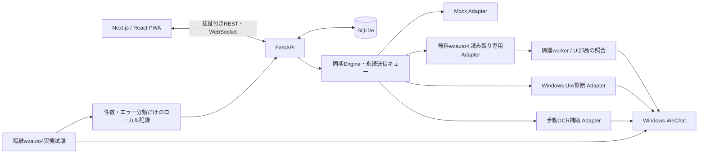

# SiverWXBot Plus調査とこもれびの構成

調査日: 2026-11-09。参照: [SiverWXbot_plus](https://github.com/SiverKing/SiverWXbot_plus/tree/a861923f6b4f792a6efb9b51f494f59bbea0d6af)、commit `a861923f6b4f792a6efb9b51f494f59bbea0d6af`。README表記はv4.8.3。

2026-11-10に本人が **wxautox4 Plusで進める方針**を選びました。既存のUI・SQLite・認証・送信キューを再利用し、Plus 41.2.3用Adapter/隔離workerを追加しています。SiverのBot本体やFlask画面は起動しません。[Plusの構成・実装範囲・実機で未検証の箇所](WXAUTOX4_PLUS.md) を参照してください。以下の上流調査表は無料版を優先していた時点の判断を含みます。

## 上流コードの調査結果

| 項目 | Siverの実装 | こもれびでの判断 |
|---|---|---|
| 依存 | `requirements.txt`: `wxautox4 >= 41.2.2`, Flask, openai, schedule, websockets等 | 無料wxauto4とは別パッケージ。有料依存は追加しない |
| 対応環境 | README: Python 3.10–3.13、Windows WeChat 4.1.9–4.2.0.12 | 本PCの4.1.8.107をこの範囲に含めない |
| 初期化 | `WXBot.init_wx_listeners` が通常版→国際版の順で初期化を試す | この切り分けを無料版の独立した検証スクリプトに反映 |
| 受信 | `AddListenChat` と `message_handle_callback(msg, chat)`。対象会話の登録・子ウィンドウ確認 | 登録対象を明示し、実際に読めた範囲だけを保存する設計に参考利用。無料版の監視可否は未検証 |
| 送信 | `chat.SendMsg` 等。自動返信・定時送信・転送の呼び出し箇所が多数 | 本体を起動しない。既存の手動送信→キュー→Adapterを維持 |
| 宛先識別 | `chat.who`、`nickname`、`chat_type`、登録した会話名を使用 | 表示名照合だけでは同名・改名・誤選択を防げない。外部IDが取得できるとは仮定しない |
| 送信結果 | `was_send_success` がbool/dict/None等を吸収 | 参考にしたが、truthyな未知オブジェクトやvoid結果を本アプリの「確認済み」にはしない。既存Receipt契約を再利用 |
| 保存 | `memory_store.py` の会話別JSON、原子的書込み、プロセス間ロック | こもれびのSQLiteマイグレーション・永続キューを継続 |
| 会話保存キー | 表示名の正規化＋元の表示名のSHA-256 | 不正文字除去による衝突を避ける仕組み。同名会話を識別するWeChat IDではない |
| Web | `web_server.py` のFlask管理画面、起動停止・設定・メモリ操作 | 代替フロントエンド向けの既存FastAPI/Next.jsを継続。Bot管理画面へ置換しない |
| ライフサイクル | `bot_lifecycle.py` の状態・停止イベント・ワーカースレッド | 既存Engine/Windows常駐監視が同じ責務を持つため重複導入しない |
| ログ | 受信callback内で本文・送信者・会話名をログ化 | ユーザーのプライバシー要件に反するためそのまま移植しない |
| AI | 複数モデルへの生成呼出しとBot返信 | 外部AI未接続を維持。必要な履歴の確認・最小化・明示実行・下書きへの反映を経由させる必要あり |

上流の非侵襲なUI操作エンジンを包む設計と、通常版／国際版の切り分けを利用しています。Siverのソースコードを直接コピーしたファイルはまだありません。既存コードにない機能だけを追加し、同じ役割のFlaskサーバーやJSONストアを新設しません。

## ライセンスの境界

- Siverリポジトリの `LICENSE` はApache-2.0。コードを直接取り込む場合はライセンス・著作権表示を保持し、改変箇所を明示し、上流のNOTICEがある場合は必要な表示も維持する方針です。
- Siverのライセンスは `wxautox4` の利用権を付与しません。上流READMEは別途デバイス認証が必要としています。購入・認証は行っていません。
- SiverPanelのリモートアクセス認証はwxautox4ライセンスと別契約です。現アプリは許可済みのWindows常駐・認証付きHTTPS経路を持つため導入しません。
- 無料wxauto4の検証wheelではLICENSE同梱・ライセンス欄を確認できず、古いwxautoリポジトリのApache表示を自動的に適用しません。wheelや改変済みパッケージは再配布せず、セットアップ時に配布元から取得します。

一次資料: [Siver LICENSE](https://github.com/SiverKing/SiverWXbot_plus/blob/a861923f6b4f792a6efb9b51f494f59bbea0d6af/LICENSE)、[依存](https://github.com/SiverKing/SiverWXbot_plus/blob/a861923f6b4f792a6efb9b51f494f59bbea0d6af/requirements.txt)、[wxauto公式インストール](https://docs.wxauto.org/docs/install.html)。

## 現在のアプリ

`WeChatAdapter` のconnect/disconnect/get_chats/get_messages/watch_messages/send_message/get_connection_status契約、共通の `Connection` と `Receipt` を維持します。ライブラリ固有オブジェクトをRESTへ露出しません。実際のReader/Senderが検証できるまでUIAは送受信を無効にし、OCRは確認付きの手動取り込みに限定します。

無料版試験は常駐処理と分離しています。既定のログ・テレメトリー設定をimport前に無効化し、Pythonネットワーク操作を拒否し、各試験に時間上限を設けます。結果は診断用で、DBへの取り込み・Adapterの切替・送信許可を行いません。実測と再実行は [無料版の検証記録](FREE_WXAUTO4_TRIAL.md) を参照してください。

## 無料wxauto4 Readerの追加

英語UIの固定ラベル・辞書に互換処理を加え、`GetSession`、`ChatInfo`、実際のテキスト解析を再利用します。プロフィール取得失敗時は自分のID・表示名を未取得に保ち、送信を有効にしません。会話の情報・送信者・方向を構造化した限定IPCを共通Adapterへ渡します。本文は非公開パイプ・DB・読み取りキャッシュだけに保持し、診断やログへ出しません。

既存Engine・SQLite・WebSocket・認証・UIを利用し、新しいBotやサーバーは作りません。マイグレーション006で `source_key` と一意制約を追加し、WeChat外部IDとは区別します。現在の会話を読み取るだけで、Siverの自動返信・会話巡回・Plusの監視機能を有効にしません。詳細と限界は [無料Reader](WXAUTO4_READER.md) を参照してください。

## 既存APIと追加開発の境界

| 要件 | 現在 |
|---|---|
| status / chats / messages GET / search | 認証付きで実装。Mockおよび保存済みの履歴を対象とする |
| POST `/api/chats/{id}/messages` | 現在の手動送信は `/api/chats/{id}/send`。同じ認証・宛先照合・キューを使う互換パスも追加済み |
| WS `/ws/events` | 現在は認証付き `/ws`。同じ認証とイベント配信の互換パスも追加済み |
| AI translate / reply / summarize | OpenAI Provider・明示確認・非同期ジョブ・結果保存・画面を実装。実APIの疎通と品質は未検証。優先度は引き続き簡易ルール |
| タスク候補・保存・検索 | 本人確認後の保存、元発言へのリンク、保存済み本文検索を実装 |
| 画像・ファイル送受信 | 未実装。Plus側のAPI記載を無料版で検証済みと扱わない |

Phase 1の調査、既存のPhase 2–3のMock基盤に加え、AI API・翻訳表示・返信案・要約・決定事項・タスク候補を実装しました。無料版の標準設定は失敗しましたが、英語UI互換Readerでは実本文の取得・保存・表示に成功しました。実AIは合成ProviderとHTTPモックによるテストまでで、疎通・品質確認済みとは扱いません。

AIはサーバー側環境変数にキーを置き、明示的に選択した最小限の会話だけを送ります。翻訳・候補・要約・タスク抽出を独立Providerにし、生成処理から送信キューやタスク保存を直接呼ばせません。ユーザーが内容を確認し、送信・タスク追加をそれぞれ操作します。方針は [AI拡張](AI_EXTENSION.md)。

Phase 4の実機受信・宛先照合・手動送信・切断復旧は [無料版検証の次の実機試験](FREE_WXAUTO4_TRIAL.md#次の実機試験の条件) に沿って実施します。機能ごとに成功・失敗・未検証を記録し、画面が見えることとAPIで取得できることを分けます。
